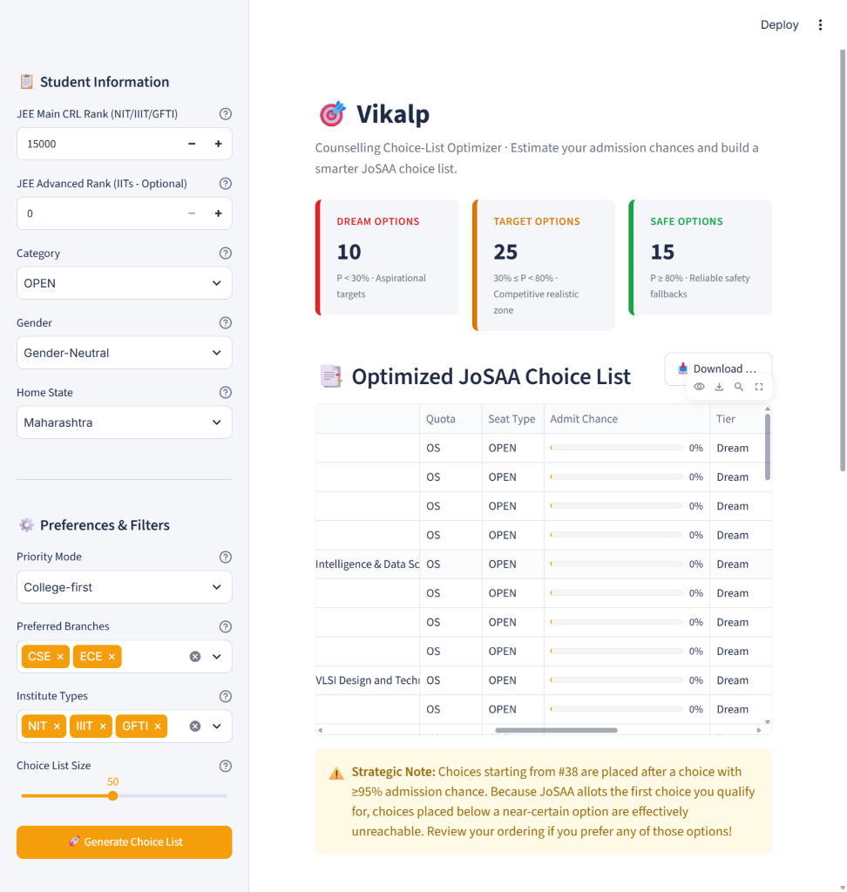

# 🎯 Vikalp: Counselling Choice-List Optimizer for JoSAA

**Author:** Sahil Sharma  
**Live Demo:** Deployed on Streamlit Community Cloud  
**Tech Stack:** Python 3.11, Streamlit, Pandas, NumPy, SciPy, LightGBM, Plotly, Playwright  

---

## 📌 Problem Statement

Every year, over 200,000 students clearing JEE Main and JEE Advanced must prepare a prioritized choice list of 50 to 100+ programs across **IITs, NITs, IIITs, and GFTIs** under extreme stress. 

Most students rely on static past-year cutoff PDFs or naive college predictors that show last year's cutoff with **zero uncertainty quantification**. This causes two severe counselling traps:
1. **Premature Allotment Trap:** Placing a safe option too high up in the choice list permanently forfeits the opportunity to be allotted higher-aspiration (Target or Dream) seats, because JoSAA allocates the **first choice** you qualify for from top to bottom.
2. **Exclusion Trap:** Submitting a list dominated by over-optimistic dream choices leaves students with no seat allotment in round 5/6.
3. **Rank & Quota Confusion:** Students routinely confuse Common Rank List (CRL) with Category Ranks (EWS, OBC-NCL, SC, ST), All India (AI) vs. Home State (HS) vs. Other State (OS) quotas, and Gender-Neutral vs. Female-only supernumerary pools.

**Vikalp** solves this by calculating statistical **admission probabilities** for every eligible program and automatically constructing an **ordered, risk-balanced JoSAA choice list** (20% Dream / 50% Target / 30% Safe) with automated warnings for unreachable choices.

---

## 📸 Screenshots



*Figure 1: Full Vikalp dashboard showing sidebar parameters, risk tier summary metric cards, interactive choice list table with admit chance progress bars, and historical closing rank trajectory chart.*

---

## 📊 Data Source & Processing

- **Data Source:** Official JoSAA Counselling Archive (`josaa.admissions.nic.in`) covering **5 consecutive cycles (2021, 2022, 2023, 2024, 2025)**.
- **Raw Volume:** 52,485 raw final-round opening and closing rank entries extracted directly from DOM tables.
- **Cleaning & Normalization:**
  - Removed all preparatory seat lists (`P`-suffix ranks).
  - Filtered quotas to standard categories: `AI`, `HS`, and `OS` (dropping out-of-scope `GO`, `JK`, and `LA` quotas).
  - Filtered seat types to standard categories: `OPEN`, `EWS`, `OBC-NCL`, `SC`, and `ST` (dropping PwD sub-allocations).
  - Normalized institute names and degrees across years, while preserving distinct seat offerings (`4-Year B.Tech` vs. `5-Year Dual Degree` vs. `BS-MS`).
  - Mapped all 129 participating institutes to their `institute_type` (`IIT`, `NIT`, `IIIT`, `GFTI`) and physical Indian `state`.
- **Final Processed Dataset:** **45,947 validated records** stored in `data/processed/cutoffs.parquet` with time-lag features (`prev_closing_1`, `prev_closing_2`, `prev_closing_3`, `mean_last_2`, `delta_1yr`, `trend_slope`, `years_of_history`).

---

## 🧠 Methodology & Mathematical Formulation

### 1. Quota & Category-Aware Eligibility Filtering
- **IIT vs. Non-IIT Separation:** IIT seats are evaluated strictly using the candidate's **JEE Advanced** rank; NIT, IIIT, and GFTI seats are evaluated strictly using **JEE Main** ranks.
- **Quota Logic:**
  - `AI` (All India): Always eligible for all students regardless of domicile state.
  - `HS` (Home State): Eligible if and only if $\text{Institute State} == \text{Student Home State}$.
  - `OS` (Other State): Eligible if and only if $\text{Institute State} \ne \text{Student Home State}$.
- **Category Ranks:** `OPEN` seats are evaluated using the student's **CRL** rank. Reserved category seats (`EWS`, `OBC-NCL`, `SC`, `ST`) are evaluated using the student's **category rank**. Category ranks are never compared against CRL cutoffs.
- **Gender Pools:** Female candidates compete for both `Gender-Neutral` and `Female-only` pools; male candidates compete strictly for `Gender-Neutral` seats.

### 2. Admission Probability Engine
A student is admitted to a choice if their rank is less than or equal to the final closing rank. We model the predicted log closing rank as $\hat{y}$ with residual uncertainty $\sigma$ measured on held-out historical cycles:

$$z = \frac{\ln(\text{student\_rank}) - \hat{y}}{\sigma}$$

$$P(\text{admit}) = 1 - \Phi(z) = \Phi(-z)$$

where $\Phi$ is the standard normal cumulative distribution function (CDF). Probabilities are clipped to $[0.01, 0.99]$ (never showing false certainty of 0% or 100%).

### 3. Risk Tiers & Mix Balancing
Options are classified into three calibrated risk zones:
- 🔴 **Dream ($P < 30\%$):** High-aspiration reach choices.
- 🟡 **Target ($30\% \le P < 80\%$):** Realistic, competitive target choices.
- 🟢 **Safe ($P \ge 80\%$):** High-confidence safety fallbacks.

The optimizer selects options to satisfy an optimal **20% Dream / 50% Target / 30% Safe** risk portfolio.

### 4. Preference Scoring & Strategic Ordering
- **College-first:** Programs are scored primarily by institutional prestige (using the historical median closing rank of OPEN CSE as an intrinsic proxy), secondarily by preferred branch hierarchy.
- **Branch-first:** Programs are scored primarily by the student's preferred branch order, secondarily by institutional prestige.
- **Strategic Ordering:** Choices are ordered strictly **Dream $\to$ Target $\to$ Safe**.
- **Unreachable-Option Warning:** If choice $\#K$ achieves $P \ge 95\%$, any choices placed *below* $\#K$ are flagged as effectively unreachable, protecting the applicant from wasted choice entries.

---

## 📈 Model Validation & Results

Models were trained on historical cycles up to 2024 and evaluated on the held-out **2025 cycle** (8,709 seat options with $\ge 2$ years history):

| Model | MAE ($\ln(\text{rank})$) | 80% Interval Coverage | Residual Sigma ($\sigma$) | Status |
|---|:---:|:---:|:---:|:---:|
| **Naive Baseline (Last Year's Cutoff)** | `0.1485` | `90.07%` | `0.2591` | Benchmark |
| **Weighted-Trend Baseline (0.5, 0.3, 0.2)** | **`0.1393`** | **`90.06%`** | **`0.2285`** | **Selected for Production** |
| **LightGBM Regressor (400 trees, lr=0.05)** | `0.1471` | `89.93%` | `0.2433` | Trained Artifact |

### Model Selection Note:
LightGBM beats the naive last-year baseline (`0.1471` vs `0.1485`). However, the **3-Year Weighted-Trend Baseline** outperforms LightGBM (`0.1393` vs `0.1471` MAE) and achieves the tightest residual variance ($\sigma = 0.2285$) with 90.06% coverage for the 80% prediction interval. Per our predefined project rules, we do not over-tune LightGBM and maintain the more accurate and explainable weighted-trend predictor in production.

---

## ⚠️ Limitations

1. **Statistical Nature:** Predictions are statistical estimates derived from historical trends and cannot account for unforeseen shifts in student sentiment or macroeconomic factors.
2. **Seat Matrix Shocks:** Significant expansions in seat capacity (e.g., adding supernumerary quotas or new campuses) can cause sudden cutoff shifts.
3. **Out-of-Scope Quotas:** v1 covers standard All India, Home State, and Other State quotas for OPEN, EWS, OBC-NCL, SC, and ST categories. PwD allocations and specialized state quotas (GO, JK, LA) are out of scope for v1.

---

## 💻 How to Run Locally

### 1. Prerequisites
- Python 3.11+
- Git

### 2. Clone the Repository
```bash
git clone https://github.com/<your-username>/vikalp.git
cd vikalp
```

### 3. Setup Virtual Environment
```bash
# Using python venv
python -m venv .venv

# Activate environment:
# Windows:
.venv\Scripts\activate
# macOS/Linux:
source .venv/bin/activate
```

### 4. Install Dependencies
```bash
pip install -r requirements.txt
```

### 5. Run the Test Suite
```bash
pytest -v
```

### 6. Launch the Streamlit App
```bash
streamlit run app/streamlit_app.py
```
Open your browser at `http://localhost:8501`.

---

## 🚀 Deployment to Streamlit Community Cloud

The repository is configured for one-click deployment on **Streamlit Community Cloud**:

1. **Push to GitHub:**
   ```bash
   git remote add origin https://github.com/<your-username>/vikalp.git
   git branch -M main
   git push -u origin main
   ```
2. **Deploy on Streamlit Cloud:**
   - Go to [share.streamlit.io](https://share.streamlit.io) and sign in with GitHub.
   - Click **"New app"**.
   - Select your repository: `<your-username>/vikalp`.
   - Set **Branch**: `main`.
   - Set **Main file path**: `app/streamlit_app.py`.
   - Click **"Deploy!"**.
3. **Zero Scraping Required on Cloud:**
   `data/processed/cutoffs.parquet` and `data/processed/institutes.csv` are tracked in the repository, enabling instant startup without external network dependencies.

---

## ⚖️ Official Disclaimer

> **Disclaimer:** Vikalp provides statistical estimates based on historical JoSAA cutoff trends. It is **not** an official seat prediction or guarantee of admission. Actual cutoff ranks fluctuate annually based on candidate preferences, seat availability, and test demographics. Always verify official notifications and matrix allocations at [josaa.nic.in](https://josaa.nic.in).

---

**Built by Sahil Sharma**
