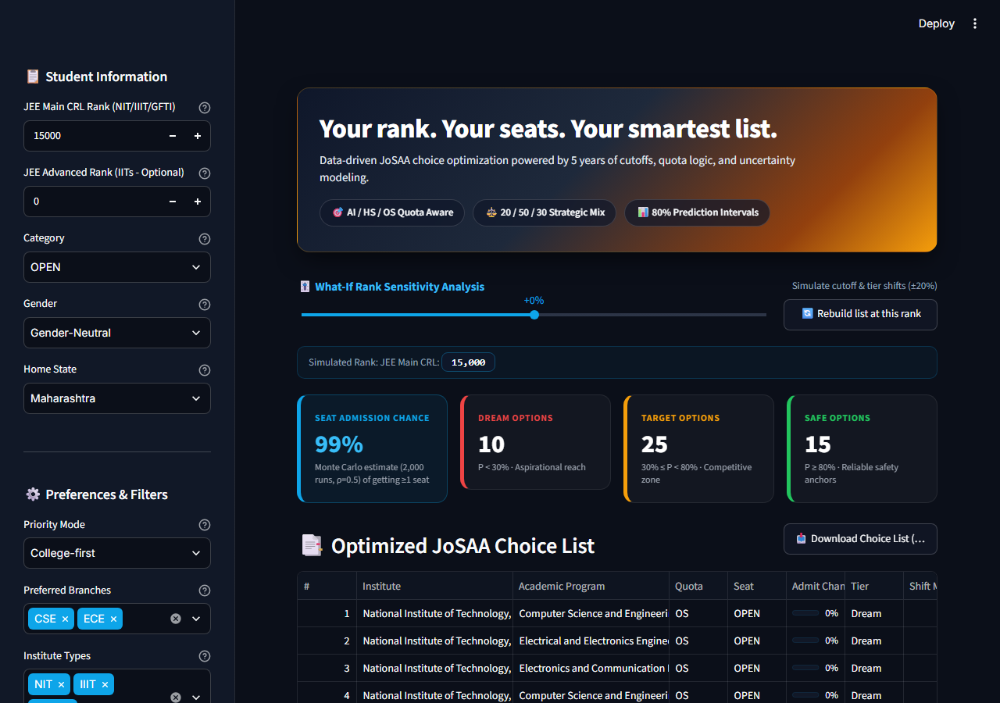
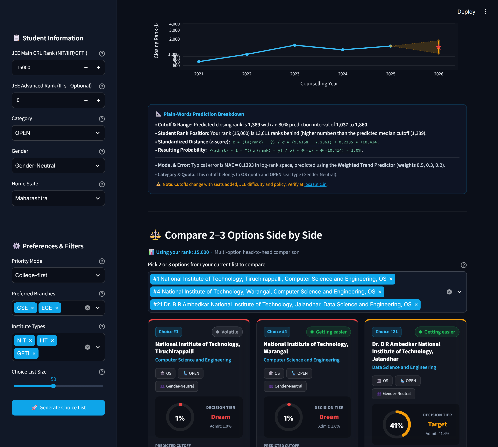
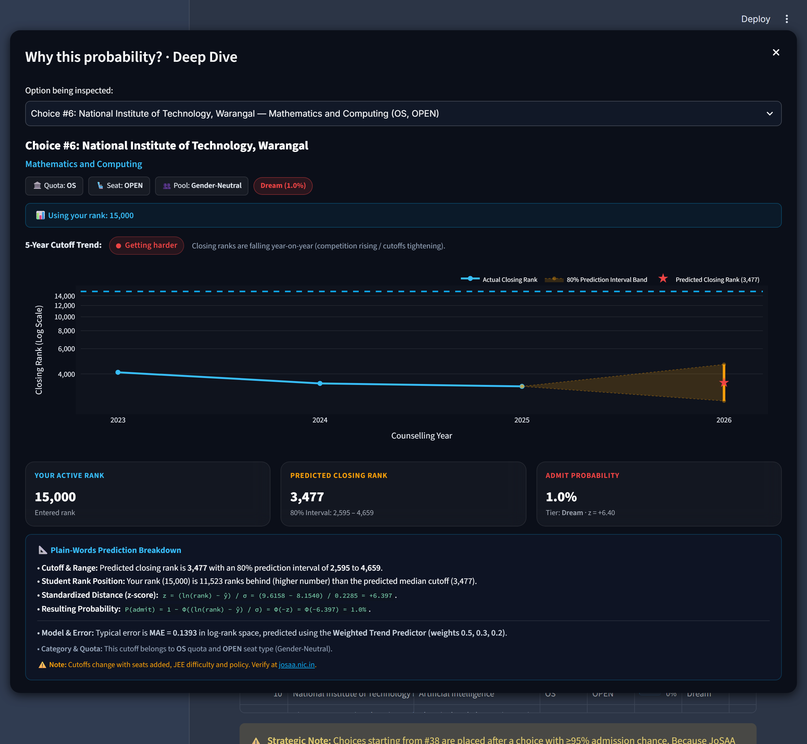
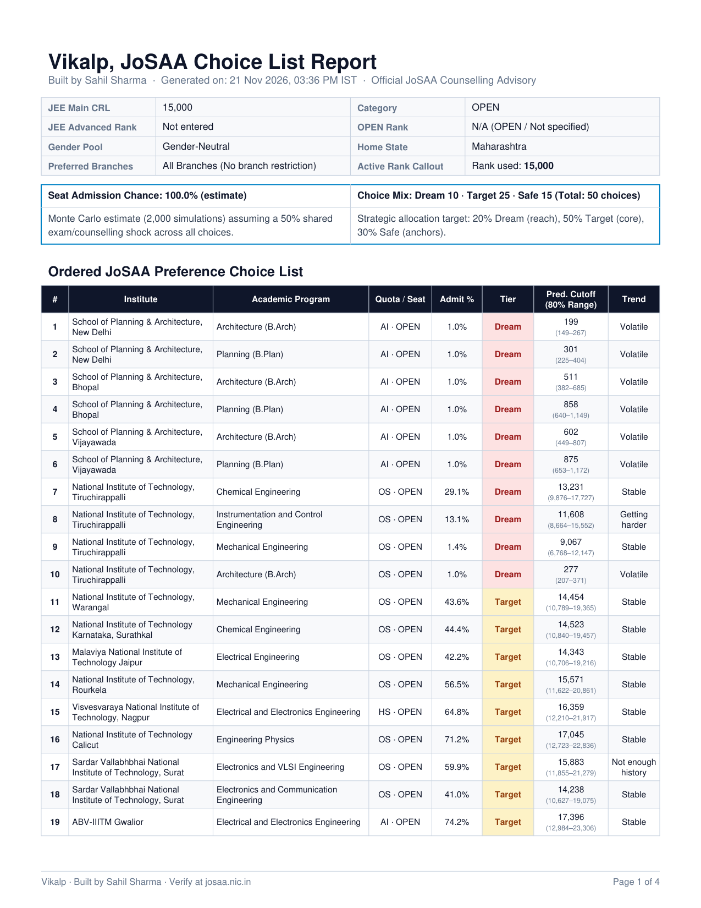

# 🎯 Vikalp: Counselling Choice-List Optimizer for JoSAA

> **Your rank. Your seats. Your smartest list.**  
> An intelligent, uncertainty-aware choice-list optimization and decision-support platform for IIT, NIT, IIIT, and GFTI admissions.

**Author:** Sahil Sharma  
**Live Demo:** [vikalp-josaa.streamlit.app](https://vikalp-josaa.streamlit.app) *(Streamlit Community Cloud Deployment Placeholder)*  
**Data Attribution:** Historical counselling and cutoff data sourced directly from the official Joint Seat Allocation Authority archive ([josaa.nic.in](https://josaa.nic.in)).

---

## 📸 Screenshots

| 1. Intelligent Choice List & What-If Toolbar | 2. Side-by-Side 3-Option Comparison Deck |
|:---:|:---:|
|  |  |

| 3. Deep-Dive "Why this probability?" Modal | 4. Executive In-Memory PDF Export Report |
|:---:|:---:|
|  |  |

---

## 📌 Problem Statement

Every year, over 250,000 engineering aspirants clearing JEE Main and JEE Advanced submit a preference list of 50 to 100+ program choices across **23 IITs, 32 NITs, 26 IIITs, and 38 GFTIs** under intense deadline stress.

Most students rely on static past-year cutoff PDFs or simplistic predictors that show last year's cutoff with **zero uncertainty quantification**. This creates critical strategic failures during seat allocation:
1. **Premature Allotment Trap:** Placing an overly safe option above competitive target options locks the student into an inferior seat. Under JoSAA rules, once you are allotted a choice, **all lower choices are permanently discarded**.
2. **Exclusion Trap:** Overfilling lists with unviable dream options results in zero allotments across all rounds.
3. **Sub-Floor Noise:** Filling choices where admission probability is essentially near zero ($< 1\%$) wastes precious slots on unreachable programs.
4. **Rank & Quota Traps:** Confusing JEE Main Common Rank List (CRL) with Category Ranks (EWS, OBC-NCL, SC, ST), All India (AI) vs. Home State (HS) vs. Other State (OS) quotas, and Gender-Neutral vs. Female-only supernumerary pools.

**Vikalp** eliminates these traps through statistical probability modeling, multi-year trend forecasting, risk-balanced list generation, and proactive allocation order warnings.

---

## 📊 Data & Processing

- **Data Source:** Official JoSAA round data (2021–2025) archived at [josaa.nic.in](https://josaa.nic.in).
- **Raw Volume:** 52,485 raw round cutoff entries extracted across all rounds.
- **Cleaning & Filtering Pipeline:**
  - Standardized target on **final-round closing ranks** for each cycle.
  - Stripped preparatory rank records (`P`-suffix ranks).
  - Normalization of quota mappings: `AI` (All India), `HS` (Home State), and `OS` (Other State).
  - Normalization of seat types: `OPEN`, `EWS`, `OBC-NCL`, `SC`, and `ST`.
  - Seat pool categorization into `Gender-Neutral` and `Female-only` (supernumerary).
  - Explicit exclusion of `B.Arch` and `B.Planning` programs (which use JEE Main Paper 2 scores, not engineering Paper 1 CRL).
  - Generated time-lag features (`prev_closing_1`, `prev_closing_2`, `prev_closing_3`, `mean_last_2`, `delta_1yr`, `trend_slope`).
- **Clean Processed Dataset:** **44,642 validated engineering records** stored in compressed Apache Parquet format at `data/processed/cutoffs.parquet` (~0.84 MB).

---

## 🧠 Methodology & Mathematical Formulation

### 1. Predicted Cutoff Model
To estimate the upcoming cycle's log closing rank $\hat{y} = \ln(\widehat{\text{CR}})$, Vikalp computes an exponentially weighted trend over the most recent available cycles:
$$\hat{y} = w_1 \ln(\text{CR}_{t-1}) + w_2 \ln(\text{CR}_{t-2}) + w_3 \ln(\text{CR}_{t-3})$$
where $(w_1, w_2, w_3) = (0.50, 0.30, 0.20)$ for programs with 3 prior years, and $(0.625, 0.375)$ for programs with 2 prior years.

### 2. Admission Probability
A student with rank $R$ is admitted if and only if $R \le \text{CR}$. Modeling log-scale cutoff variations as Gaussian perturbations with standard deviation $\sigma$:
$$z = \frac{\ln(R) - \hat{y}}{\sigma}, \quad P(\text{admit}) = 1 - \Phi(z) = \Phi(-z)$$
Probabilities are clipped to $[0.01, 0.99]$.

### 3. Risk Tiers & Minimum Probability Floor
- **Minimum Probability Floor (`MIN_LIST_PROB = 0.05`):** Choices with $P < 5\%$ are strictly excluded to ensure no slots are squandered on unviable options.
- **Dream ($5\% \le P < 30\%$):** High-aspiration reach choices; maximum upside with zero allocation penalty.
- **Target ($30\% \le P < 80\%$):** Competitive core choices tightly calibrated to the candidate's rank.
- **Safe ($P \ge 80\%$):** High-certainty safety anchors to guarantee allotment.
- **Risk-Balanced Allocation:** Automatically balances lists to **20% Dream / 50% Target / 30% Safe**. If fewer than $N$ options meet the 5% threshold, Vikalp returns a shorter list rather than padding with sub-floor choices.

### 4. Portfolio Admission Chance (Correlated Monte Carlo)
The overall probability of securing at least one seat across a list of $M$ options is simulated via a 2,000-run Monte Carlo simulation:
$$z_i = \sqrt{\rho} \cdot s + \sqrt{1 - \rho} \cdot e_i, \quad s, e_i \overset{\text{i.i.d.}}{\sim} \mathcal{N}(0, 1)$$
where $s$ represents a shared macro exam/counselling shift (default correlation $\rho = 0.50$), $e_i$ represents program-specific shocks, and $\text{CR}_i = \exp(\hat{y}_i + \sigma z_i)$.

### 5. JoSAA Sequential Order Alert
Under JoSAA allocation mechanics, choices are evaluated strictly from #1 downwards. Any choice placed below an option with $P \ge 95\%$ is flagged as **effectively unreachable**.

---

## 📈 Model Performance & Calibration Results

### Comparative Validation on Held-Out Year (2025)

| Model | Log-Rank MAE | 80% Prediction Interval Coverage | App Status |
|---|---|---|---|
| **Naive Last-Year Baseline** | 0.1485 | 90.07% | Reference |
| **Weighted Trend Predictor** | **0.1393** | **90.06%** | **Active in Production App** |
| **LightGBM Regressor** | 0.1471 | 89.93% | Explored (Benchmarked) |

> **Production Choice:** The app intentionally uses the **Weighted Trend Predictor**. It outperforms the naive baseline by ~0.01 log points, matches LightGBM accuracy, requires zero heavy framework overhead, and provides complete, transparent auditability for counselling students.

### Multi-Year Prediction Interval Calibration ($\sigma = 0.2285$)

| Held-Out Cycle | Evaluated Programs | MAE (Log Rank) | Raw Std ($\sigma_{\text{yr}}$) | 50% Interval Coverage | 80% Interval Coverage | 90% Interval Coverage | Brier Score |
|---|---|---|---|---|---|---|---|
| **2023** | 7,481 | 0.1587 | 0.2272 | 64.38% | **87.23%** | 92.25% | 0.1535 |
| **2024** | 8,003 | 0.1486 | 0.2273 | 68.09% | **87.42%** | 92.15% | 0.1483 |
| **2025** | 8,709 | 0.1393 | 0.2285 | 70.34% | **90.06%** | 93.77% | 0.1430 |

### Why $\sigma = 0.2285$ Was Retained
Empirical coverage for the nominal 80% interval spans **87.2% to 90.1%** across held-out cycles. This occurs because cutoff residuals are **leptokurtic (heavy-tailed)**: most programs have tiny year-over-year shifts ($|e| < 0.10$), while new seat additions or branch restructuring create occasional larger outliers.

When $\sigma$ was scaled down to $0.1540$ to force nominal 80% coverage on 2025, **the Brier score degraded in every year** (e.g. 2025 Brier worsened from $0.1430 \to 0.1712$; 2023 80% coverage dropped to $74.96\%$). In college admissions counselling, **understating risk is catastrophic** (leading students to skip essential safety choices), whereas conservative coverage provides protective safety buffers. Thus, $\sigma = 0.2285$ is deliberately preserved.

---

## ⚡ Features (v1.0 & v1.1)

- **Quota-Aware Eligibility Engine:** Accurately routes CRL and Category ranks (EWS, OBC-NCL, SC, ST) and enforces physical Home-State domicile boundaries.
- **Seat Admission Chance:** Real-time Monte Carlo estimate (2,000 simulations, $\rho = 0.5$) with 1-decimal display capped at 99.9%.
- **What-If Rank Sensitivity Slider:** Instant in-place rescoring ($\pm 20\%$ in 5% steps) with sub-second `@st.cache_data` response and an optional "Rebuild list at this rank" button.
- **Why This Probability? Deep Dive:** Modal and inline panel showing 5-year closing rank history, Plotly log-scale trajectory with shaded 80% prediction interval, student rank reference line, 5-year trend badges (*Getting harder*, *Getting easier*, *Volatile*, *Stable*), and plain-words formula breakdowns.
- **Side-by-Side 2–3 Option Comparison:** Multi-select deck with colorblind-accessible Plotly multi-series charts (distinct line styles and marker shapes), aligned metric comparison table, JoSAA allocation reachability check, and deterministic quick facts.
- **In-Memory PDF Report Generator:** Print-friendly white layout via ReportLab (`BytesIO`), multi-page choice table with repeated headers, two-pass `NumberedCanvas` (*"Page X of Y"*), dagger footnote for unreachable choices, methodology guide, and official verification disclaimers.

---

## ⚠️ Known Limitations

1. **B.Arch and B.Planning Excluded:** Architecture and Planning seats are allotted via JEE Main Paper 2 ranks. Vikalp v1 focuses on engineering degrees (B.Tech, B.S., Dual Degree) using Paper 1 CRL.
2. **Single Global Sigma ($\sigma$):** Uses a calibrated global residual standard error ($\sigma = 0.2285$) across all branches rather than institute-tier-specific variances.
3. **Final Round Data Only:** Models Round 5/6 final closing ranks. Opening rounds fluctuate and are not modeled.
4. **Special Quotas Out of Scope:** Preparatory seats, PwD reservations, and regional quotas (`JK`, `LA`, `GO`) are excluded.
5. **Advisory Tool Only:** Historical probability estimates do not guarantee admission.

---

## 🚀 How to Run & Test

### Prerequisites
- Python 3.11+
- Virtual environment tool (`venv` or `uv`)

### Local Setup
```bash
# Clone the repository
git clone https://github.com/<your-username>/vikalp.git
cd vikalp

# Create and activate virtual environment
python -m venv .venv
source .venv/bin/activate       # On Linux/macOS
# .venv\Scripts\activate        # On Windows

# Install production dependencies
pip install -r requirements.txt

# Run the Streamlit web app
streamlit run app/streamlit_app.py
```

### Running Tests
```bash
# Install developer dependencies (pypdf, pymupdf)
pip install -r requirements-dev.txt

# Run the full test suite
pytest tests/ -v
```

---

## 📁 Project Structure

```
vikalp/
├── .github/
│   └── workflows/
│       └── tests.yml             # GitHub Actions CI for Ubuntu Linux (Python 3.11)
├── app/
│   ├── streamlit_app.py          # Interactive Streamlit application
│   └── styles.css                # Glassmorphic dark theme stylesheet
├── data/
│   └── processed/
│       ├── cutoffs.parquet       # Cleaned multi-year JoSAA closing cutoffs (44,642 rows)
│       └── institutes.csv        # Normalized institute directory (129 institutes)
├── docs/
│   ├── calibration.png           # Multi-year calibration curve & PIT histogram
│   └── screenshots/              # High-resolution application screenshots
├── models/
│   ├── lgbm.joblib               # LightGBM validation benchmark model
│   └── metrics.json              # Calibrated residual sigma and error metrics
├── scripts/
│   ├── check_calibration.py      # Calibration and Brier score evaluation script
│   └── run_sanity_evaluations.py # Sanity verification suite across student profiles
├── src/
│   ├── baseline.py               # Weighted trend forecasting engine
│   ├── clean.py                  # Raw cutoff cleaning and normalization pipeline
│   ├── compare.py                # Side-by-side option comparison engine
│   ├── eligibility.py            # Quota, state, category, and gender eligibility filters
│   ├── features.py               # Time-lag feature engineering
│   ├── optimize.py               # Risk-balanced choice-list optimizer (MIN_LIST_PROB = 0.05)
│   ├── pdf_report.py             # In-memory ReportLab PDF generator (NumberedCanvas)
│   ├── predict.py                # Statistical probability and prediction interval functions
│   ├── simulation.py             # Correlated Monte Carlo portfolio simulation (rho = 0.5)
│   ├── trend.py                  # 5-year trend slope classifier and badge generator
│   └── whatif.py                 # Real-time rank sensitivity rescoring engine
├── tests/
│   ├── conftest.py               # Pytest path configuration
│   ├── test_compare.py           # Comparison engine and query parameter tests
│   ├── test_edge_cases.py        # Boundary tests (empty, zero, negative, extreme ranks)
│   ├── test_optimizer.py         # Optimizer, floor, and risk-mix tests
│   ├── test_pdf.py               # PDF generation, escaping, and text extraction tests
│   ├── test_probability.py       # Probability formula and CDF bounds tests
│   ├── test_simulation.py        # Monte Carlo simulation tests
│   ├── test_trend.py             # Trend badge classification tests
│   └── test_whatif.py            # What-If sensitivity tests
├── pytest.ini                    # Root pytest configuration (pythonpath = .)
├── requirements.txt              # Pinned production dependencies
└── requirements-dev.txt          # Developer test dependencies (pypdf, pymupdf)
```

---

## 🗺️ Future Roadmap

- [ ] **Empirical-Residual / Student-$t$ Probabilities:** Upgrade from Gaussian assumption to Student-$t$ distributions or empirical rank-residual lookup to better capture heavy cutoff tails.
- [ ] **Smart Trim of Unreachable Choices:** Automatically offer a 1-click option to prune choices ordered below a $\ge 95\%$ option and backfill with high-value alternatives.
- [ ] **Per-Group Sigma Scaling:** Fit separate $\sigma$ values by institute tier (IIT vs. NIT vs. IIIT) and branch volatility.
- [ ] **State Counselling Expansion:** Support state-level engineering counselling portals (KCET in Karnataka, MHT-CET in Maharashtra).
- [ ] **Multilingual UI:** Complete Hindi translation of the choice generator for Tier-2/3 applicants.
- [ ] **FastAPI Backend & Containerization:** Package backend into standalone FastAPI microservice with Docker containerization.

---

## 👤 Author & Acknowledgments

- **Built by:** Sahil Sharma
- **Data Source:** Joint Seat Allocation Authority ([josaa.nic.in](https://josaa.nic.in))
- **License:** MIT License

---

## ⚖️ Legal Disclaimer

*Vikalp provides statistical decision-support estimates based strictly on historical JoSAA counselling data (2021–2025). These estimates do not represent official allotment predictions or admission guarantees. Opening and closing cutoffs fluctuate every year due to exam difficulty, candidate preference shifts, and annual seat matrix revisions. Candidates must verify official cutoffs, seat matrices, and counselling rules at [josaa.nic.in](https://josaa.nic.in).*
