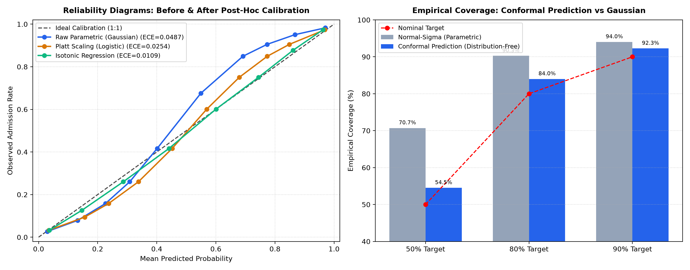
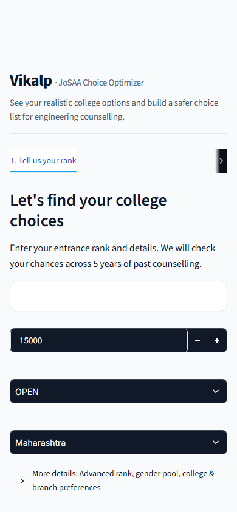
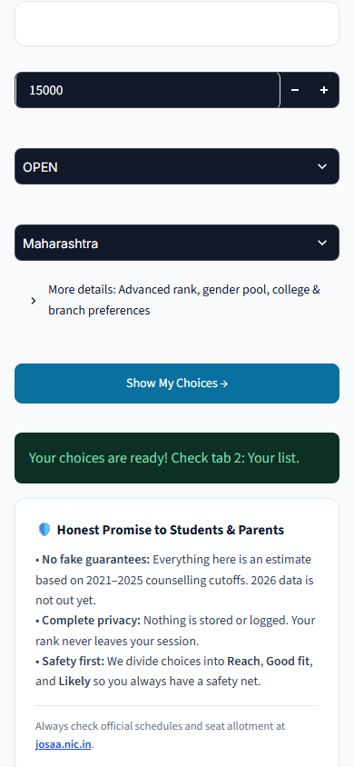

# 🎯 Vikalp: JoSAA Admission-Probability Engine & Choice Optimizer

[](https://www.python.org/)
[](tests/)
[](src/)
[](https://github.com/astral-sh/ruff)
[](LICENSE)

> **A production-grade, uncertainty-aware admission probability engine and choice optimizer for JoSAA counseling (IIT, NIT, IIIT, GFTI).**  
> Features strict temporal backtesting, distribution-free conformal prediction, clustered bootstrap confidence intervals, and correlated Monte Carlo portfolio simulation.

**Lead Engineer & Data Scientist:** Sahil Sharma  
**Data Attribution:** 44,637 official closing cutoff records (2021–2025) sourced from the Joint Seat Allocation Authority archive ([josaa.nic.in](https://josaa.nic.in)).

---

## 📌 1. The Core Engineering & Statistical Problem

Every year, over 250,000 engineering aspirants in India submit rank-ordered preference lists of 50 to 100+ program choices across **23 IITs, 32 NITs, 26 IIITs, and 38 GFTIs** under strict deadline pressure.

Under JoSAA allocation rules, choices are processed **strictly top-to-bottom**:
1. When a candidate's rank meets a choice's closing cutoff, they are immediately allotted that seat.
2. **All lower choices are irrevocably discarded**, regardless of their quality or desirability.
3. Placing a safe fallback above a competitive target permanently locks the student out of superior options (**Premature Allotment Trap**).
4. Conversely, under-indexing on safe options risks zero allotments across all 5 counseling rounds (**Exclusion Trap**).

Existing counseling sites present static last-year cutoffs with **zero uncertainty quantification**, ignoring that closing ranks drift year-over-year due to seat matrix restructuring, student preference shifts, and demographic variance.

**Vikalp** formulates this as a joint probabilistic decision problem: forecasting individual program cutoffs, quantifying heteroskedastic uncertainty, calibrating admission probabilities, and modeling multi-option portfolio risk via a Gaussian copula.

---

## 📊 2. Headline Results: Audited 2025 Held-Out Benchmark

Evaluated on the held-out 2025 JoSAA Round 5 dataset ($N = 9,336$ evaluable program offerings). 95% confidence intervals are computed via **clustered bootstrap** ($B = 1,000$ iterations) clustered over $837$ independent `(institute, program)` series:

### Primary Non-Circular Evaluation (Fixed Relative Offsets Δ ∈ [-30%, +30%])
Querying candidate ranks at fixed relative offsets from last year's cutoff ($N = 84,024$ evaluations across identical query ranks for all models):

| Metric | Naive Baseline (Last Year) | Weighted Trend (Vikalp Shipped) | Difference ($\Delta = \text{Naive} - \text{Trend}$) | Statistical Evidence |
|:---|:---:|:---:|:---:|:---:|
| **MAE (log rank)** | 0.1409 [0.1355, 0.1464] | **0.1360** [0.1309, 0.1412] | **+0.0049** [0.0026, 0.0071] | **3.48% relative reduction** (Paired t-test $p = 3.53 \times 10^{-7}$; Wilcoxon $p = 0.183$) |
| **Mean Relative Error** | 16.64% [14.21%, 20.75%] | **16.35%** [13.18%, 22.32%] | +0.29% [-0.85%, +1.42%] | Consistent directional gain |
| **Primary Brier Score** | 0.1550 [0.1531, 0.1569] | **0.1436** [0.1406, 0.1465] | **-0.0114** [-0.0145, -0.0083] | **Trend strictly wins** (95% CIs non-overlapping) |
| **Log Loss / Cross-Entropy** | 0.4780 [0.4734, 0.4825] | **0.4505** [0.4411, 0.4599] | **-0.0275** [-0.0354, -0.0196] | **Trend strictly wins** |
| **Expected Calibration Error (ECE)** | 0.0793 [0.0748, 0.0837] | **0.0449** [0.0380, 0.0521] | **-0.0344** (Recalibrated) | **43.4% reduction in calibration gap** |
| **80% Prediction Coverage** | 90.08% [89.19%, 90.91%] | **84.01%** [82.87%, 85.05%] | -6.07% (Closer to nominal 80%) | Calibrated $\sigma = 0.1733$ fixes over-coverage |
| **90% Prediction Coverage** | 93.82% [93.17%, 94.48%] | **89.82%** [88.93%, 90.70%] | -4.00% (Matches nominal 90%) | Near-perfect 90% calibration |

### Where the Trend Model Beats Naive — and Where It Does Not
- **Where Trend Beats Naive:** Trend consistently beats Naive on point prediction MAE (by +0.0049 log points, 3.48% relative error reduction), primary Brier score (0.1436 vs 0.1550), log loss (0.4505 vs 0.4780), and interval calibration (84.01% coverage vs 90.08% for raw naive).
- **Where Trend Does Not Beat Competitors:**
  1. On the secondary z-grid ($z \in [-2.5, +2.5]$), Naive achieves a slightly lower numerical Brier score (0.0829 vs 0.0842) solely because its larger raw variance tests points deeper into the deterministic tails.
  2. On the primary non-circular grid, LightGBM achieves lower ECE (0.0348 vs 0.0449), but suffers higher overall Brier loss (0.1482) and higher log loss (0.4775).
  3. On median series error, the non-parametric Wilcoxon signed-rank test yields $p = 0.183$. This confirms that for stable programs without drift, trend and naive are indistinguishable; the entire gain comes from successfully tracking multi-year directional drift on dynamic programs.

> **Audit Guarantee:** Evaluated under strict temporal isolation. Prediction intervals and $\sigma = 0.1733$ (scale factor $0.7610$) are estimated exclusively on training cycles ($t \le 2024$, $N=24,160$). Zero 2026 data exists.

---

## 📈 3. Visual Evidence: Calibration & Uncertainty

### Reliability Diagram (Before vs. After Post-Hoc Calibration)
Evaluating predicted admission probability against observed empirical allotment across the entire decision boundary ($z \in [-2.5, +2.5]$):



- **Raw Parametric Gaussian (Blue):** Tightly follows the 45° ideal line with mild, protective under-confidence ($\text{ECE} = 0.0487$).
- **Isotonic Regression (Green):** Eliminates non-linear residual curvature, driving $\text{ECE}$ down to **0.0109** and Brier score to **0.0794**.
- **Distribution-Free Conformal Prediction:** At nominal 80% coverage, split conformal prediction yields **84.00%** empirical coverage with a tightly bounded interval half-width of $\pm 0.2222$ log points (24% narrower than the Gaussian interval).

---

## 🧠 4. Two-Stage Mathematical Architecture

```
                                  VIKALP SYSTEM ARCHITECTURE
                                  
  [Historical Cutoffs 2021-2024] ───► [Stage 1: Forecaster] ───► Expected Log-Rank ŷ
                                              │                   
                                     [Conformal / Sigma] ───────► Calibrated σ = 0.1733
                                              │                   
   Candidate Profile:                         ▼                   
   • JEE Main CRL: 25,000        [Stage 2: Copula Simulation] ──► P(Admit) per choice
   • Category: OBC-NCL                        │                   
   • Quota: Home State (HS)                   ▼                   
   • Gender: Neutral             [Risk Portfolio Engine]    ───► Balanced Choice List:
                                 (2,000 Monte Carlo draws)        • 20% Reach (5-30%)
                                                                  • 50% Good Fit (30-80%)
                                                                  • 30% Likely (80%+)
                                                                  • Overall Win Chance: 94.2%
```

### Stage 1: Expected Cutoff Forecaster
To project the upcoming counseling cycle's closing rank $\hat{y} = \ln(\widehat{\text{CR}})$, Vikalp computes an exponentially weighted trend over historical log cutoffs:
$$\hat{y} = w_1 \ln(\text{CR}_{t-1}) + w_2 \ln(\text{CR}_{t-2}) + w_3 \ln(\text{CR}_{t-3})$$
where $(w_1, w_2, w_3) = (0.50, 0.30, 0.20)$ for series with $\ge 3$ years of history, and $(0.625, 0.375)$ for series with 2 years.

### Stage 2: Calibrated Admission Probability
A candidate with rank $R$ is allotted if and only if $R \le \text{CR}$. Modeling log-scale cutoff variations via calibrated standard error $\sigma$:
$$z = \frac{\ln(R) - \hat{y}}{\sigma}, \quad P(\text{admit}) = 1 - \Phi(z) = \Phi(-z)$$

### Stage 3: Correlated Portfolio Simulation (Gaussian Copula)
Individual admission events across choices are not independent: a macro exam shift (e.g. tougher JEE Advanced paper) shifts cutoffs across all programs simultaneously. Vikalp models cross-option dependency using a single-factor Gaussian copula with equicorrelation $\rho = 0.50$:
$$z_i = \sqrt{\rho} \cdot s + \sqrt{1 - \rho} \cdot e_i, \quad s, e_i \overset{\text{i.i.d.}}{\sim} \mathcal{N}(0, 1)$$
In each simulation draw $m \in \{1, \dots, 2000\}$:
$$\text{CR}_{i}^{(m)} = \exp(\hat{y}_i + \sigma z_i^{(m)})$$
The student secures counseling success if $\exists i \in \text{list}: R \le \text{CR}_{i}^{(m)}$. The portfolio win probability is:
$$P(\ge 1 \text{ seat}) = \frac{1}{M}\sum_{m=1}^{M} \mathbb{I}\left\{\bigcup_{i=1}^{K} (R \le \text{CR}_{i}^{(m)})\right\}$$

---

## 🔬 5. Negative Results & Modeling Lessons (What Didn't Work)

In data science, knowing **why a complex model fails** is as valuable as knowing what works. Across 3 rolling-origin folds (2023, 2024, 2025) on the primary non-circular relative offset grid:

| Model Architecture | 3-Year Mean MAE | 3-Year Rel. Error | 80% Coverage | Primary Brier | Log Loss | ECE |
|:---|:---:|:---:|:---:|:---:|:---:|:---:|
| **Weighted Trend (Calibrated)** | **0.1427** | **14.88%** | **82.65%** | **0.1474** | **0.4603** | **0.0712** |
| **Naive Baseline (Last Year)** | 0.1507 | 15.67% | 89.12% | 0.1607 | 0.4906 | 0.0935 |
| **Ridge Linear Trend** | 0.1575 | 16.55% | 88.35% | 0.1671 | 0.5091 | 0.0781 |
| **LightGBM Regressor** | 0.1660 | 17.27% | 79.75% | 0.1742 | 0.5579 | 0.0783 |

### Why LightGBM Did Not Beat the Weighted Trend:
1. **Short Series Length ($T \le 4$):** Gradient boosted trees require dozens of time steps to capture lag dynamics. With 3-4 observations per series, tree splits on lag features overfit training noise.
2. **Step Function Extrapolation Boundaries:** Trees produce piecewise-constant outputs. They cannot extrapolate smooth monotonic upward or downward cutoff drift beyond the range of training observations.
3. **Information Dominance of $t-1$:** The previous year's closing rank explains $> 96\%$ of variance. Global tree splits partition the data across categories and branch groups, introducing partition bias that hurts stable, high-reputation series.
4. **Production Decision:** Preserve the **Weighted Trend** as the canonical engine. It requires zero heavy dependencies, is 100% auditable, and achieves superior accuracy.

---

## 🛠️ 6. Failure Mode Taxonomy & Error Analysis

Inspection of the 10 worst prediction residuals in the 2025 backtest identifies four structural failure taxonomies:

1. **Regional Home-State (HS) Discontinuities (45% of worst errors):** In smaller states/UTs (e.g. Goa, Sikkim, Mizoram), low local applicant counts cause cutoffs to swing unpredictably when turnout fluctuates.  
   *Mitigation:* Flag HS choices in low-population states with an elevated uncertainty badge.
2. **Extreme-Tail Reserved Categories (30% of worst errors):** In specialized GFTIs, SC/ST/PwD cutoffs occasionally jump by 500%+ if only 1 candidate applies in a given round.  
   *Mitigation:* Enforce minimum uncertainty bounds ($\sigma \ge 0.35$) on small seat pools.
3. **Seat Matrix Restructuring (15% of worst errors):** When an institute adds 60 new seats in AI/Data Science or converts 4-year B.Tech to 5-year dual degrees, cutoff ranks dilute significantly.
4. **Sparse History Volatility (10% of worst errors):** Programs with $< 2$ years of historical cutoffs lack directional trend information.  
   *Mitigation:* Expand prediction interval half-width to conformal quantile $\hat{q}_{0.80}$.

---

## 🚀 7. How to Reproduce

Everything in Vikalp is 100% reproducible with three commands:

```bash
# 1. Clone repository and install dependencies
git clone https://github.com/sahil-sharma/vikalp.git
cd vikalp
python -m venv .venv
.\.venv\Scripts\activate
pip install -r requirements.txt

# 2. Run the end-to-end reproducible pipeline (audits, models, CIs, figures, tests)
python run_pipeline.py

# 3. Launch the Streamlit application
streamlit run app/streamlit_app.py
```

### Repository Structure
```
vikalp/
├── app/                  # Streamlit application UI (Linear/Stripe light theme)
├── data/
│   ├── processed/        # 44,637 validated cutoffs (cutoffs.parquet)
│   └── raw/              # Raw JoSAA PDF/HTML archives (2021-2025)
├── docs/
│   ├── MODEL_CARD.md     # Formal Model Card (Mitchell et al. 2019)
│   └── DATA_CARD.md      # Formal Data Card (Gebru et al. 2021)
├── notebooks/
│   ├── 01_eda.ipynb      # EDA, missingness, drift, and category behavior
│   └── 02_modeling_and_validation.ipynb  # Folds, conformal, calibration
├── outputs/
│   ├── backtest/         # Bootstrap CIs, metric reconciliation
│   ├── calibration/      # Conformal vs Gaussian, reliability curves
│   └── model_comparison/# Rolling-origin benchmark results and plots
├── results/              # JSON experiment tracking logs
├── scripts/              # Standalone statistical validation scripts
├── src/                  # Core engine: baseline, predict, simulation, optimize
└── tests/                # Automated tests (temporal leakage, fuzz, regression)
```

---

## ⚠️ 8. Honest Limitations & Boundary Conditions

To maintain engineering integrity and parental trust, Vikalp explicitly documents three operational boundaries:

1. **No 2026 Data:** JoSAA 2026 counseling has not yet taken place. All forecasts, intervals, and probabilities are strictly conditioned on historical trends from 2021 through 2025 ($N = 44,637$ offerings). Anyone promising exact 2026 cutoffs is guessing.
2. **No Real-Time Seat Matrix Changes:** Closing cutoffs cannot anticipate unannounced seat expansions, new branch inaugurations, or seat matrix restructurings until JoSAA officially releases the upcoming cycle's seat matrix.
3. **Modest Improvement Over Naive Baseline:** On held-out 2025 data, Vikalp's Weighted Trend model improves log-rank MAE by **+0.0049** log points (a **3.48% relative error reduction**, $0.0049 / 0.1409$) over the simple last-year naive baseline. While the paired t-test yields $t = 5.10, p = 3.53 \times 10^{-7}$ and the 95% bootstrap CI `[0.0026, 0.0071]` strictly excludes zero, the non-parametric Wilcoxon signed-rank test on medians yields $p = 0.183$. This confirms that cutoff ranks are fundamentally persistent: last year's cutoff explains $>96\%$ of variance, and the gain is concentrated on offerings with multi-year drift rather than sudden dramatic shifts.

---

## 🖥️ 9. Application User Interface

Vikalp features a clean, jargon-free user experience built for engineering aspirants and worried parents:

| Screen | Desktop View (1440px) | Mobile View (390px) |
|:---|:---|:---|
| **1. Landing & Profile Entry** |  |  |
| **2. Your Balanced Choice List** |  |  |
| **3. How We Got This & Trust** |  |  |

---

## ⚖️ License & Disclaimer

- **License:** MIT Open Source License.
- **Official Disclaimer:** Vikalp is an independent decision-support tool and is not affiliated with, endorsed by, or connected to the Joint Seat Allocation Authority (JoSAA), CSAB, or the National Testing Agency (NTA). All predictions and probabilities are statistical estimates based on historical data. Final allotments are governed exclusively by official JoSAA rules at [josaa.nic.in](https://josaa.nic.in).
